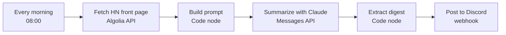

# n8n: Daily Hacker News AI Digest

A small [n8n](https://n8n.io) workflow that posts an AI-written summary of the Hacker News front page to Discord every morning. It is a single importable JSON file with 6 nodes and no code to deploy.

## How it works

| Node | What it does |
|---|---|
| **Every morning** | Schedule trigger, daily at 08:00 |
| **Fetch HN front page** | `GET` the top 15 stories from the public HN Algolia API (no key needed) |
| **Build prompt** | JavaScript turns the stories into a numbered list and wraps it in an instruction |
| **Summarize with Claude** | `POST` to the Anthropic Messages API (`claude-opus-5-5`, low effort) |
| **Extract digest** | Keeps only the `text` blocks of the reply and adds a heading |
| **Post to Discord** | Sends the digest to a Discord webhook, trimmed to Discord's 2,000-character limit |

Calling the API with a plain HTTP Request node means no extra community node is needed.

## Setup

1. In n8n, choose **Import from File** and select `workflow.json`.
2. Create an **HTTP Header Auth** credential named `Anthropic API key`, with header name `x-api-key` and your key as the value. Select it on the *Summarize with Claude* node.
3. Paste your Discord webhook URL into the *Post to Discord* node.
4. Click **Execute workflow** to test it, then toggle the workflow to **Active**.

## Customizing

- Change the schedule in the first node.
- Change `tags=front_page` in the fetch node to `ask_hn` or `show_hn`.
- Swap the Discord node for Slack, email or Telegram. The digest text is in `$json.digest`.
- Edit the prompt in *Build prompt* to change the tone or length.

## Notes

- The two Code nodes were tested locally with mock data. I haven't run the full workflow inside a live n8n instance.
- The credential ID in the export is a placeholder, so you'll be asked to select your own credential after import.
